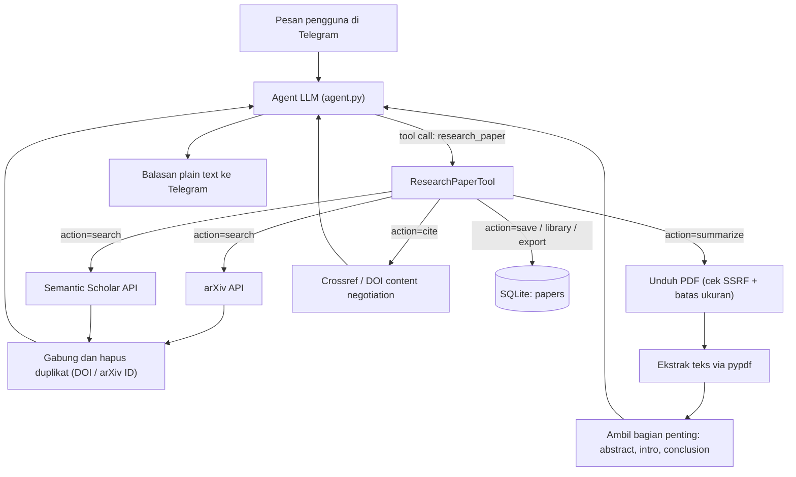
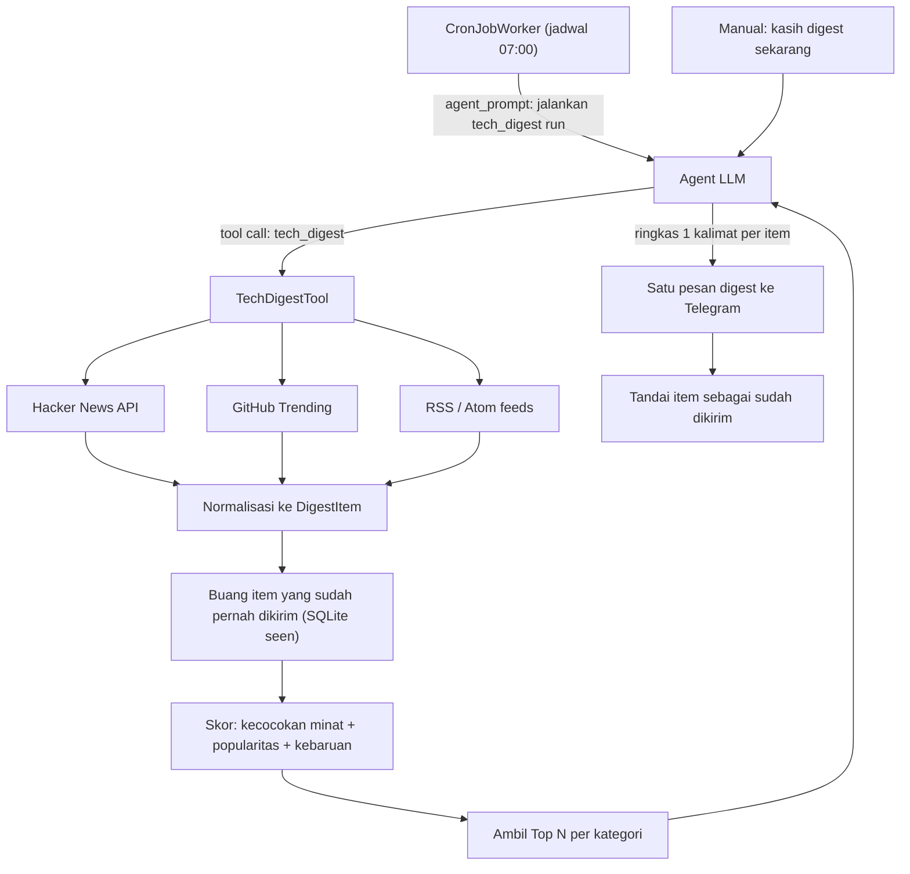
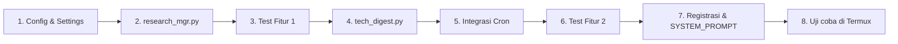

# Spesifikasi Fitur: Paper Research Assistant & Tech Digest Harian

Dokumen ini menjelaskan rancangan dua fitur baru untuk faf-agent, yaitu cara kerja, package yang dibutuhkan, struktur kode, keamanan, dan langkah implementasinya.

> [!NOTE]
> Kedua fitur ini dipakai sepenuhnya lewat Telegram, jadi HP cukup menyala di background dengan Termux. Kamu tidak perlu membuka HP-nya.

---

## Keputusan yang Sudah Disepakati

| No | Keputusan | Nilai |
|---|---|---|
| 1 | Prioritas implementasi | **Fitur 1 (Paper Research Assistant) dulu**, Fitur 2 menyusul |
| 2 | Topik minat digest | Keamanan siber, teknologi terbaru, dan berita teknologi berkualitas tinggi |
| 3 | Tahap saat ini | **Finalisasi dokumen**, belum mulai coding |

---

## Ringkasan

| Aspek | Fitur 1: Paper Research Assistant | Fitur 2: Tech Digest Harian |
|---|---|---|
| Tujuan | Mencari, meringkas, dan menyitasi paper ilmiah | Ringkasan berita teknologi otomatis setiap pagi |
| File tool baru | `src/tools/research_mgr.py` | `src/tools/tech_digest.py` |
| Nama tool (LLM) | `research_paper` | `tech_digest` |
| Sumber data | arXiv, Semantic Scholar, Crossref/DOI | Hacker News, GitHub Trending, RSS/Atom |
| Butuh API key? | Tidak (key Semantic Scholar opsional) | Tidak (token GitHub opsional) |
| Package baru | **Tidak ada** | **Tidak ada** |
| Pemicu | Perintah pengguna di chat | Cron terjadwal + perintah manual |

> [!IMPORTANT]
> Kedua fitur ini **tidak menambah dependensi baru**. Semuanya cukup pakai `httpx` (sudah ada), modul standar Python (`xml.etree`, `html.parser`, `sqlite3`, `json`), dan `pypdf` yang sudah dipakai oleh `pdf_mgr.py`. Jadi tetap sesuai invarian Zero Native Compilation.

---

## Fitur 1: Paper Research Assistant

### 1.1 Apa yang Bisa Dilakukan

- Mencari paper berdasarkan topik atau kata kunci (contoh: "cari paper tentang retrieval augmented generation 2024").
- Menampilkan detail paper: judul, penulis, tahun, jumlah sitasi, abstrak, dan link PDF.
- Mengunduh PDF lalu meringkasnya (masalah, metode, hasil, dan keterbatasan).
- Membuat sitasi dalam format BibTeX, APA, atau IEEE.
- Menyimpan paper ke "perpustakaan pribadi" supaya bisa dibuka lagi nanti.
- Mengekspor seluruh perpustakaan ke berkas `.bib` lalu mengirimkannya sebagai dokumen Telegram.

### 1.2 Contoh Interaksi di Telegram

```
Kamu : cari paper terbaru soal small language model untuk edge device
Bot  : Nemu 5 paper yang relevan:
       1. MobileLLM: Optimizing Sub-billion Parameter LMs (2024), 120 sitasi
       2. TinyLlama: An Open-Source Small LM (2024), 340 sitasi
       ...
       Mau aku ringkas yang mana?

Kamu : ringkas nomor 1
Bot  : MobileLLM fokus ke model di bawah 1 miliar parameter untuk HP.
       Masalah: ...
       Metode: ...
       Hasil: ...
       Keterbatasan: ...

Kamu : simpan dan kasih bibtex-nya
Bot  : Sudah disimpan ke perpustakaan. Ini BibTeX-nya:
       @article{liu2024mobilellm, ...}
```

### 1.3 Cara Kerja



Alurnya per action:

1. **`search`**
   - Query dikirim paralel (`asyncio.gather`) ke arXiv dan Semantic Scholar.
   - Hasil dinormalisasi ke satu struktur `PaperItem`, lalu duplikatnya dihapus berdasarkan DOI atau arXiv ID.
   - Hasil diurutkan berdasarkan relevansi dan jumlah sitasi (bisa disaring per tahun).
   - Kembalikan maksimal 5 sampai 10 hasil dalam format daftar bernomor yang ringkas.
   - Hasil terakhir disimpan di cache per `chat_id` supaya pengguna bisa bilang "ringkas nomor 2".

2. **`detail`**
   - Ambil metadata lengkap dari Semantic Scholar (`/graph/v1/paper/{id}`): abstrak, penulis, venue, sitasi, referensi, dan `openAccessPdf`.

3. **`summarize`**
   - Cari URL PDF: arXiv (`https://arxiv.org/pdf/{id}`) atau `openAccessPdf` dari Semantic Scholar.
   - Validasi URL dengan `_check_url_safety`, lalu unduh secara streaming dengan batas ukuran (misalnya 25 MB).
   - Simpan ke `PAPERS_DIR` (default `~/papers/`).
   - Ekstrak teks dengan `pypdf`, lalu potong secara cerdas: abstract, introduction, dan conclusion diprioritaskan, dengan batas sekitar 12.000 karakter supaya hemat token.
   - Teks dikembalikan ke LLM utama, dan LLM yang menyusun ringkasan dengan struktur tetap (masalah, metode, hasil, keterbatasan).
   - Kalau PDF tidak tersedia, ringkasan dibuat dari abstrak saja dan pengguna diberi tahu.

4. **`cite`**
   - Kalau ada DOI: `GET https://doi.org/{doi}` dengan header `Accept: application/x-bibtex` (BibTeX) atau `text/x-bibliography; style=apa` (APA).
   - Kalau hanya ada arXiv ID: BibTeX dibuat secara lokal dari metadata.
   - IEEE dibuat dengan formatter lokal.

5. **`save` / `library` / `export`**
   - Paper disimpan ke tabel SQLite `papers` lengkap dengan tag dan catatan.
   - `export` membuat berkas `library.bib` lalu mengirimkannya lewat `ToolResult(media_path=..., media_type="document")`.

### 1.4 Sumber Data & API

| Sumber | Endpoint | Key | Batas Rate | Kegunaan |
|---|---|---|---|---|
| arXiv | `http://export.arxiv.org/api/query?search_query=...` | Tidak | 1 request per 3 detik | Paper CS/AI terbaru, preprint |
| Semantic Scholar | `https://api.semanticscholar.org/graph/v1/paper/search` | Opsional | Tanpa key: terbatas dan dibagi bersama | Jumlah sitasi, venue, link PDF open access |
| Crossref / doi.org | `https://doi.org/{doi}` (content negotiation) | Tidak | Longgar | BibTeX dan APA resmi |

> [!TIP]
> Minta API key Semantic Scholar secara gratis di semanticscholar.org/product/api supaya tidak sering terkena error 429 (rate limit).

Sesuai minatmu, pencarian arXiv secara default diprioritaskan ke kategori berikut. Pengguna tetap bisa mencari di luar kategori ini.

- `cs.CR`: Cryptography and Security (keamanan siber)
- `cs.AI`, `cs.LG`, `cs.CL`: AI, machine learning, dan NLP (teknologi terbaru)
- `cs.NI`, `cs.SE`: jaringan dan rekayasa perangkat lunak

### 1.5 Package yang Dibutuhkan

| Package | Status | Kegunaan |
|---|---|---|
| `httpx` | Sudah ada | HTTP client async (pakai ulang client tunggal) |
| `xml.etree.ElementTree` | Modul standar | Parsing respons Atom XML dari arXiv |
| `pypdf` | Sudah dipakai `pdf_mgr.py` | Ekstraksi teks PDF |
| `sqlite3` | Modul standar | Perpustakaan paper |
| `re`, `json`, `hashlib` | Modul standar | Normalisasi dan deduplikasi |

Di Termux tidak perlu instalasi tambahan. Kalau `pypdf` belum terpasang:

```bash
pip install pypdf
```

`pypdf` adalah pure Python, jadi aman untuk Termux.

### 1.6 Struktur Kode

```python
# src/tools/research_mgr.py
from __future__ import annotations

import logging
from dataclasses import dataclass, field
from typing import Any

from src.tools.base import BaseTool, ToolContext, ToolResult

logger = logging.getLogger("faf_agent.tools.research_mgr")


@dataclass
class PaperItem:
    title: str
    authors: list[str]
    year: int | None
    abstract: str = ""
    doi: str | None = None
    arxiv_id: str | None = None
    s2_id: str | None = None
    citation_count: int | None = None
    venue: str | None = None
    pdf_url: str | None = None
    source: str = ""  # "arxiv" | "semantic_scholar"
    tags: list[str] = field(default_factory=list)


class ArxivClient:
    async def search(self, query: str, limit: int, year_from: int | None) -> list[PaperItem]: ...

class SemanticScholarClient:
    async def search(self, query: str, limit: int, year_from: int | None) -> list[PaperItem]: ...
    async def detail(self, paper_id: str) -> PaperItem | None: ...

class CitationFormatter:
    async def bibtex(self, paper: PaperItem) -> str: ...
    def apa(self, paper: PaperItem) -> str: ...
    def ieee(self, paper: PaperItem) -> str: ...

class PaperLibrary:
    """SQLite store dilindungi threading.RLock, koneksi ditutup bersih."""
    def save(self, chat_id: int, paper: PaperItem, note: str = "") -> None: ...
    def list(self, chat_id: int, tag: str | None = None) -> list[PaperItem]: ...
    def export_bib(self, chat_id: int) -> str: ...


class ResearchPaperTool(BaseTool):
    name = "research_paper"
    description = (
        "Cari, ringkas, sitasi, dan simpan paper ilmiah dari arXiv dan "
        "Semantic Scholar. Gunakan untuk permintaan riset akademik."
    )
    parameters = {
        "type": "object",
        "properties": {
            "action": {
                "type": "string",
                "enum": ["search", "detail", "summarize", "cite",
                         "save", "library", "export"],
            },
            "query": {"type": "string", "description": "Kata kunci pencarian"},
            "paper_ref": {
                "type": "string",
                "description": "Nomor hasil terakhir (mis. '2'), DOI, atau arXiv ID",
            },
            "year_from": {"type": "integer"},
            "limit": {"type": "integer", "default": 5},
            "style": {"type": "string", "enum": ["bibtex", "apa", "ieee"]},
            "tag": {"type": "string"},
        },
        "required": ["action"],
    }

    async def execute(self, context: ToolContext, **kwargs: Any) -> ToolResult: ...
```

### 1.7 Skema Database

```sql
CREATE TABLE IF NOT EXISTS papers (
    id              INTEGER PRIMARY KEY AUTOINCREMENT,
    chat_id         INTEGER NOT NULL,
    paper_key       TEXT NOT NULL,       -- DOI / arxiv_id / s2_id
    title           TEXT NOT NULL,
    authors_json    TEXT NOT NULL,
    year            INTEGER,
    venue           TEXT,
    doi             TEXT,
    arxiv_id        TEXT,
    pdf_url         TEXT,
    local_pdf_path  TEXT,
    abstract        TEXT,
    summary         TEXT,                -- cache ringkasan supaya tidak boros token
    tags            TEXT,
    note            TEXT,
    created_at      TEXT NOT NULL,
    UNIQUE(chat_id, paper_key)
);
```

Lokasi DB disarankan satu berkas dengan `memory_store` atau `~/.faf-agent/research.db`.

### 1.8 Konfigurasi (`.env` dan `src/config.py`)

```env
# Opsional
SEMANTIC_SCHOLAR_API_KEY=
PAPERS_DIR=~/papers
RESEARCH_MAX_PDF_MB=25
RESEARCH_SUMMARY_MAX_CHARS=12000
```

Tambahkan field-field ini ke dataclass `Settings` di `src/config.py`.

### 1.9 Keamanan & Batasan

- Semua URL PDF wajib lolos `_check_url_safety` (anti-SSRF), termasuk setelah redirect.
- Unduhan dilakukan secara streaming dengan batas ukuran, dan `Content-Type` harus `application/pdf`.
- Path penyimpanan divalidasi lewat `src/tools/path_security.py`.
- Batas rate arXiv dihormati dengan `asyncio.Lock` dan jeda 3 detik antar request.
- Untuk error 429 dari Semantic Scholar: retry dengan backoff maksimal 2 kali. Kalau tetap gagal, pakai hasil arXiv saja.
- Periksa `context.cancel_event.is_set()` saat mengunduh dan mengekstrak PDF.
- Pesan error dibuat ramah, tanpa stack trace.

---

## Fitur 2: Tech Digest Harian

### 2.1 Apa yang Bisa Dilakukan

- Setiap pagi (misalnya jam 07:00 WIB) mengirim satu pesan ringkasan berita teknologi.
- Sumber: Hacker News, GitHub Trending, dan blog atau RSS pilihan kamu.
- Berita disaring berdasarkan **minat kamu** (misalnya: AI, Python, Rust, security).
- Berita yang sudah pernah dikirim tidak dikirim ulang (ada deduplikasi).
- Bisa dipanggil manual: "kasih digest sekarang" atau "digest khusus AI".
- Sumber RSS dan topik minat bisa dikelola langsung dari chat.

### 2.2 Contoh Pesan Digest

```
Tech Digest, Jumat 23 Okt 2026

Keamanan Siber
1. [PENTING] Zero-day di VPN gateway populer sedang aktif dieksploitasi, patch sudah tersedia.
   thehackernews.com/...
2. Peneliti menemukan paket npm berbahaya yang mencuri token GitHub (supply chain attack).
   bleepingcomputer.com/...
3. CISA menambahkan 3 CVE baru ke daftar Known Exploited Vulnerabilities.
   ...

Teknologi Terbaru
1. Linux 6.18 rilis, membawa dukungan Rust yang lebih luas di driver.
   news.ycombinator.com/item?id=...
2. Paper baru soal reasoning model yang lebih hemat compute.
   ...

GitHub Trending
1. owner/repo-name (Go, +1.2k bintang hari ini)
   Scanner kerentanan container yang ringan dan cepat.
...

Balas "detail 2" kalau mau aku jelaskan lebih dalam.
```

> [!NOTE]
> Format pesan tetap **plain text tanpa markdown dan tanpa tabel**, sesuai aturan UX Telegram di AGENTS.md. Pesan dijaga di bawah 4096 karakter (batas Telegram) dengan maksimal sekitar 12 item.

### 2.3 Cara Kerja



Alurnya per tahap:

1. **Penjadwalan**
   - Saat pengguna bilang "aktifkan digest jam 7 pagi", tool membuat `CronJobItem` lewat `CronJobStore` yang sudah ada:
     - `execution_type="agent_prompt"`
     - `prompt="Jalankan tech_digest action=run lalu kirim ringkasannya."`
     - `schedule="0 7 * * *"`, `timezone="Asia/Jakarta"`
   - Jadi tidak perlu worker baru karena `CronJobWorker` yang sekarang sudah cukup.

2. **Pengambilan data (paralel dengan `asyncio.gather`, timeout per sumber 15 detik)**
   - **Hacker News**: Algolia API `https://hn.algolia.com/api/v1/search?tags=front_page`, ambil judul, URL, poin, dan jumlah komentar.
   - **GitHub Trending**: scrape `https://github.com/trending?since=daily` dengan `html.parser` bawaan. Fallback-nya GitHub Search API (`/search/repositories?q=created:>YYYY-MM-DD&sort=stars`) kalau struktur HTML berubah.
   - **RSS/Atom**: parsing dengan `xml.etree.ElementTree`, dengan dukungan RSS 2.0 dan Atom 1.0.
   - Kalau satu sumber gagal, sumber lain tetap jalan dan pesan diberi catatan kecil "(HN sedang tidak bisa diakses)".

3. **Deduplikasi**
   - Kunci unik = `sha1(url yang dinormalisasi)`, yaitu tanpa `utm_*`, tanpa fragment, dan dalam huruf kecil.
   - Item yang sudah ada di tabel `digest_seen` dibuang.
   - Data lebih dari 30 hari dihapus otomatis.

4. **Penilaian & penyaringan**
   - Buang dulu item yang tidak lolos filter kualitas (lihat bagian 2.5), kecuali item keamanan kritis.
   - `skor = 0.5 * kecocokan_minat + 0.3 * popularitas_ternormalisasi + 0.2 * kebaruan`
   - Kecocokan minat dihitung dengan mencocokkan kata kunci tiap kelompok topik (bagian 2.5) ke judul dan deskripsi, lalu dikalikan bobot kelompoknya.
   - Item dikelompokkan ke kategori pesan: Keamanan Siber (maks 5), Teknologi Terbaru (maks 4), GitHub Trending (maks 3).

5. **Peringkasan**
   - Tool mengembalikan daftar item terstruktur ke LLM.
   - LLM menulis satu kalimat ringkas dalam bahasa Indonesia untuk tiap item. Hanya ada satu kali panggilan LLM untuk semua item, supaya hemat.

6. **Pengiriman**
   - Hasil dikirim lewat jalur `deliver_notification` yang sudah ada di `CronJobWorker`.
   - Setelah terkirim, item ditandai di `digest_seen`.

### 2.4 Sumber Data & API

| Sumber | Endpoint | Key | Catatan |
|---|---|---|---|
| Hacker News (Algolia) | `https://hn.algolia.com/api/v1/search?tags=front_page` | Tidak | JSON, cepat, stabil |
| GitHub Trending | `https://github.com/trending?since=daily` | Tidak | Scraping HTML, rawan berubah |
| GitHub Search API | `https://api.github.com/search/repositories` | Opsional | Fallback; token menaikkan batas rate |
| RSS/Atom | URL feed bebas | Tidak | Default disarankan di bawah |

**Rekomendasi RSS default (disesuaikan dengan minatmu):**

Keamanan siber:
- The Hacker News (thehackernews.com): berita serangan, malware, dan kerentanan terbaru
- BleepingComputer: insiden keamanan dan ransomware
- Krebs on Security: investigasi kejahatan siber
- Schneier on Security: analisis keamanan dan kriptografi
- Google Project Zero Blog: riset kerentanan teknis yang mendalam
- CISA Cybersecurity Advisories: peringatan resmi soal kerentanan yang sedang dieksploitasi

Teknologi terbaru:
- Ars Technica, The Verge Tech: berita teknologi umum
- Simon Willison's Weblog: AI dan LLM praktis
- Hugging Face Blog: model dan ML
- arXiv cs.CR (keamanan) dan cs.AI RSS: riset terbaru, nyambung dengan Fitur 1

Komunitas berkualitas tinggi:
- Lobsters (`https://lobste.rs/rss`): kurasi komunitas, banyak bahasan teknis mendalam
- Hacker News front page (sudah termasuk lewat API)

### 2.5 Profil Minat Pengguna

Topik yang kamu pilih diterjemahkan menjadi tiga kelompok kata kunci untuk penilaian:

| Kelompok | Bobot | Contoh kata kunci |
|---|---|---|
| Keamanan siber | 1.0 (tertinggi) | security, cyber, vulnerability, CVE, exploit, zero-day, malware, ransomware, breach, phishing, pentest, CTF, OWASP, APT, backdoor, supply chain |
| Teknologi terbaru | 0.8 | release, launch, AI, LLM, open source, Linux, Rust, Python, cloud, kernel, chip, quantum |
| Berkualitas tinggi | dipakai sebagai filter | tidak berbasis kata kunci, tapi berbasis popularitas (lihat di bawah) |

"Teknologi yang sangat bagus" diterjemahkan sebagai **filter kualitas**, bukan topik:

- Hacker News: hanya item dengan minimal 100 poin, atau 50 komentar.
- GitHub Trending: hanya repo dengan minimal 200 bintang baru hari ini.
- RSS: hanya dari sumber yang ada di daftar terpercaya di atas.
- Item keamanan siber dengan kata kunci kritis (zero-day, CVE kritis, "actively exploited") **selalu lolos** walaupun poinnya rendah, karena sifatnya mendesak.

Susunan pesan digest disesuaikan dengan prioritas ini:

1. Bagian **Keamanan Siber** ditaruh paling atas (maksimal 5 item).
2. **Teknologi Terbaru** (maksimal 4 item).
3. **GitHub Trending** (maksimal 3 repo).

Profil ini disimpan di tabel `digest_topics` dan bisa diubah dari chat, misalnya "tambahin topik blockchain ke digest".

### 2.6 Package yang Dibutuhkan

| Package | Status | Kegunaan |
|---|---|---|
| `httpx` | Sudah ada | Fetch semua sumber secara async |
| `xml.etree.ElementTree` | Modul standar | Parser RSS/Atom |
| `html.parser` | Modul standar | Scraper GitHub Trending |
| `sqlite3` | Modul standar | Tabel `digest_seen` dan `digest_sources` |
| `hashlib`, `urllib.parse` | Modul standar | Normalisasi URL dan hash |

> [!TIP]
> Package `feedparser` (pure Python) bisa jadi alternatif parser RSS yang lebih toleran terhadap feed rusak, tapi **tidak wajib**. Parser berbasis `xml.etree` sudah cukup untuk feed yang umum.

### 2.7 Struktur Kode

```python
# src/tools/tech_digest.py
from __future__ import annotations

import logging
from dataclasses import dataclass
from typing import Any

from src.tools.base import BaseTool, ToolContext, ToolResult

logger = logging.getLogger("faf_agent.tools.tech_digest")


@dataclass
class DigestItem:
    source: str          # "hn" | "github" | "rss"
    title: str
    url: str
    description: str = ""
    score: int = 0       # poin HN / bintang hari ini
    published_at: float | None = None
    extra: str = ""      # bahasa repo, nama blog, dll.


class HackerNewsFetcher:
    async def fetch(self, limit: int = 30) -> list[DigestItem]: ...

class GitHubTrendingFetcher:
    async def fetch(self, language: str | None = None) -> list[DigestItem]: ...

class RSSFetcher:
    async def fetch(self, feed_urls: list[str]) -> list[DigestItem]: ...

class DigestStore:
    """SQLite: sumber RSS, topik minat, dan item yang sudah dikirim."""
    def is_seen(self, chat_id: int, url_hash: str) -> bool: ...
    def mark_seen(self, chat_id: int, items: list[DigestItem]) -> None: ...
    def add_source(self, chat_id: int, url: str, name: str) -> None: ...
    def set_topics(self, chat_id: int, topics: list[str]) -> None: ...


class TechDigestTool(BaseTool):
    name = "tech_digest"
    description = (
        "Buat ringkasan berita teknologi dari Hacker News, GitHub Trending, "
        "dan RSS pilihan. Juga mengatur jadwal digest harian dan topik minat."
    )
    parameters = {
        "type": "object",
        "properties": {
            "action": {
                "type": "string",
                "enum": ["run", "schedule", "unschedule", "add_source",
                         "remove_source", "list_sources", "set_topics"],
            },
            "topic_filter": {"type": "string", "description": "Fokus sementara, mis. 'AI'"},
            "time": {"type": "string", "description": "Jam kirim format HH:MM 24 jam"},
            "source_url": {"type": "string"},
            "source_name": {"type": "string"},
            "topics": {"type": "array", "items": {"type": "string"}},
        },
        "required": ["action"],
    }

    async def execute(self, context: ToolContext, **kwargs: Any) -> ToolResult: ...
```

### 2.8 Skema Database

```sql
CREATE TABLE IF NOT EXISTS digest_sources (
    id         INTEGER PRIMARY KEY AUTOINCREMENT,
    chat_id    INTEGER NOT NULL,
    name       TEXT NOT NULL,
    url        TEXT NOT NULL,
    enabled    INTEGER NOT NULL DEFAULT 1,
    UNIQUE(chat_id, url)
);

CREATE TABLE IF NOT EXISTS digest_topics (
    chat_id    INTEGER PRIMARY KEY,
    topics     TEXT NOT NULL          -- JSON, mis. {"cyber": [...], "tech": [...], "quality": {"hn_min_points": 100}}
);

CREATE TABLE IF NOT EXISTS digest_seen (
    chat_id    INTEGER NOT NULL,
    url_hash   TEXT NOT NULL,
    sent_at    REAL NOT NULL,
    PRIMARY KEY (chat_id, url_hash)
);
```

### 2.9 Konfigurasi (`.env` dan `src/config.py`)

```env
# Opsional
GITHUB_TOKEN=
DIGEST_DEFAULT_TIME=07:00
DIGEST_MAX_ITEMS=12
DIGEST_SEEN_RETENTION_DAYS=30
DIGEST_HN_MIN_POINTS=100
DIGEST_GITHUB_MIN_STARS_TODAY=200
```

### 2.10 Keamanan & Batasan

- URL RSS yang ditambahkan pengguna wajib lolos `_check_url_safety` (tolak IP privat, localhost, dan metadata cloud).
- Ukuran respons feed dibatasi (misalnya 2 MB) supaya tidak menghabiskan RAM HP.
- Parsing XML dibungkus `try/except ET.ParseError`, jadi satu feed rusak tidak menggagalkan seluruh digest.
- Scraper GitHub harus defensif: kalau hasil parsing kosong, langsung pakai fallback Search API.
- Satu kali digest cukup satu panggilan LLM, supaya hemat token dan biaya.
- Kirim tepat 1 balon chat sesuai aturan maksimal 2 balon.

---

## Persiapan di Termux (Penting karena HP Jarang Dipegang)

Karena digest berjalan otomatis setiap pagi, HP harus tetap terjaga:

```bash
# Supaya Termux tidak ditidurkan Android
termux-wake-lock

# Pastikan zona waktu benar
echo $TZ   # idealnya Asia/Jakarta
```

- Di pengaturan Android: **Battery > Termux > Unrestricted**.
- Jalankan bot di `tmux` supaya tetap hidup walaupun sesi SSH putus.
- Pastikan HP terhubung ke WiFi atau data dan tetap tercolok charger kalau dibiarkan lama.

---

## Langkah Implementasi



| No | Langkah | File | Perkiraan |
|---|---|---|---|
| 1 | Tambah field konfigurasi baru | `src/config.py`, `.env.example` | 15 menit |
| 2 | Implementasi client arXiv, Semantic Scholar, formatter sitasi, library | `src/tools/research_mgr.py` | 3 sampai 4 jam |
| 3 | Unit test dengan `httpx.MockTransport` (tanpa internet) | `tests/test_research_mgr.py` | 1 sampai 2 jam |
| 4 | Implementasi fetcher HN, GitHub, RSS, dan store | `src/tools/tech_digest.py` | 3 sampai 4 jam |
| 5 | Action `schedule` membuat `CronJobItem` | `src/tools/tech_digest.py` | 1 jam |
| 6 | Unit test parser RSS/Atom, dedup, skoring | `tests/test_tech_digest.py` | 1 sampai 2 jam |
| 7 | Daftarkan di `create_default_registry()` dan tambahkan ke `SYSTEM_PROMPT` | `src/tools/__init__.py`, `src/core/agent.py` | 30 menit |
| 8 | Uji coba nyata di HP via Telegram | - | 1 jam |

### Skenario Test yang Wajib Ada

**Fitur 1**
- Parsing respons Atom arXiv menjadi `PaperItem` dengan benar.
- Deduplikasi paper yang muncul di arXiv dan Semantic Scholar sekaligus.
- Fallback ke arXiv saja ketika Semantic Scholar mengembalikan 429.
- Penolakan URL PDF yang mengarah ke IP privat.
- Penolakan PDF di atas batas ukuran.
- Format BibTeX, APA, dan IEEE sesuai contoh.
- Referensi "nomor 2" diambil dari cache hasil pencarian terakhir.

**Fitur 2**
- Parsing feed RSS 2.0 dan Atom 1.0.
- Feed rusak tidak menggagalkan seluruh digest.
- Item yang sudah dikirim tidak muncul lagi.
- Normalisasi URL (hapus `utm_*` dan fragment).
- Fallback GitHub Search API saat scraping kosong.
- Action `schedule` membuat cron job dengan zona waktu `Asia/Jakarta`.
- Panjang pesan akhir di bawah 4096 karakter.

---

## Pengembangan Lanjutan (Opsional)

- **Hubungkan kedua fitur**: item arXiv di digest bisa langsung diproses dengan "ringkas paper nomor 3" lewat Fitur 1.
- **Digest mingguan**: rangkuman paper paling banyak disitasi minggu ini, sesuai topik minat.
- **Ekspor ke Obsidian/Notion**: simpan ringkasan paper sebagai berkas `.md` ke folder sinkronisasi.
- **Pantau penulis atau topik**: notifikasi saat penulis favorit merilis paper baru di arXiv.
