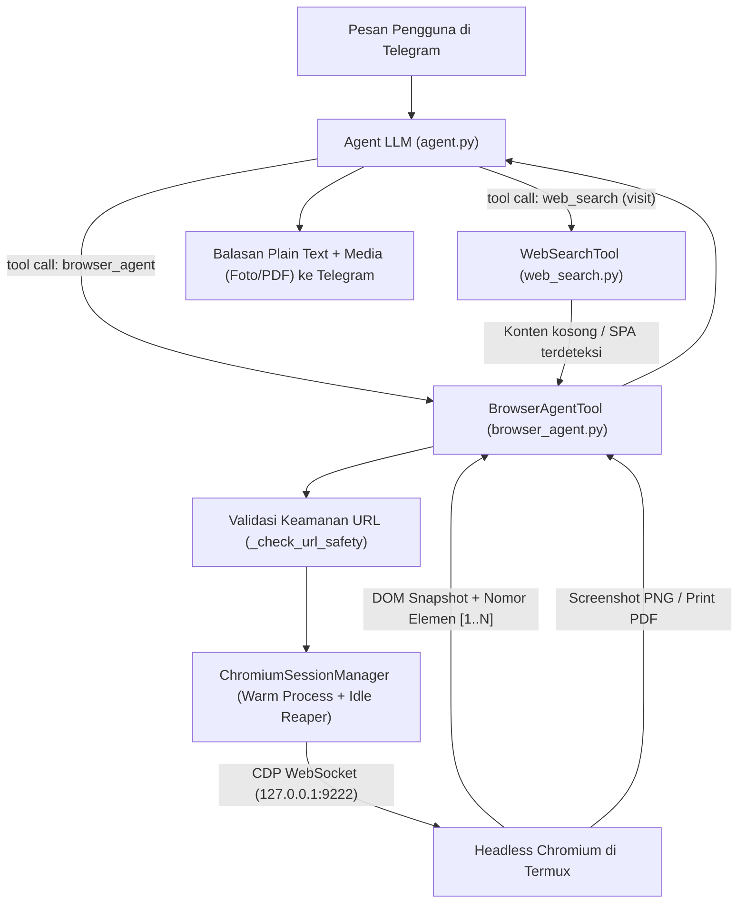
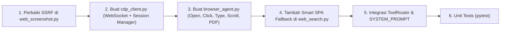

# Spesifikasi Upgrade Fitur Browser AI Agent (`faf-agent`)

Dokumen ini berisi rancangan arsitektur dan spesifikasi teknis untuk meningkatkan kemampuan **Browser AI Agent** pada `faf-agent` di lingkungan Termux Android.

> [!IMPORTANT]
> Sesuai instruksi, dokumen ini adalah **rancangan spesifikasi (belum melakukan perubahan kode)**. Seluruh rancangan mematuhi invarian **100% Pure Python & Zero Native Compilation (Zero Rust/Maturin)** sehingga tidak memerlukan `playwright` atau `selenium` yang berat di Termux ARM64.

---

## 1. Evaluasi Kondisi Saat Ini & Keterbatasan

Saat ini `faf-agent` memiliki dua tool terkait web:
1. **`web_search` (`src/tools/web_search.py`):** Mengambil halaman web menggunakan `httpx` (HTTP statis) lalu mem-parsing HTML mentah.
2. **`web_screenshot` (`src/tools/web_screenshot.py`):** Menjalankan proses baru `chromium --headless=new --screenshot=...` setiap kali dipanggil.

### Keterbatasan Utama Saat Ini

| No | Masalah pada Implementasi Sekarang | Dampak Nyata di Lapangan |
|---|---|---|
| 1 | **Gagal membaca web modern (SPA / CSR)** | Situs berbasis React, Vue, Next.js, atau dashboard kampus/riset hanya mengembalikan `<div id="root"></div>` kosong saat dibaca oleh `web_search` (`action="visit"`). |
| 2 | **Tidak bisa berinteraksi dengan halaman** | Agen tidak bisa mengklik tombol, mengisi kolom pencarian/form, memilih dropdown, menekan tombol *Load More*, atau melakukan *scroll* pada halaman *infinite scroll*. |
| 3 | **Cold-start Chromium berulang (3–8 detik/panggilan)** | Setiap `web_screenshot` menyalakan dan mematikan proses Chromium dari nol. Tidak ada sesi yang bertahan antar langkah. |
| 4 | **Belum bisa ekspor halaman web ke PDF** | Belum ada fitur mengubah artikel panjang, dokumentasi, atau halaman web menjadi berkas `.pdf` rapi yang dikirim ke Telegram. |
| 5 | **Celah SSRF pada `web_screenshot.py`** | Berbeda dengan `web_search.py`, tool `web_screenshot.py` saat ini belum memanggil `_check_url_safety()`, sehingga URL lokal/IP privat belum diblokir sebelum dikirim ke Chromium. |

---

## 2. Ringkasan Upgrade yang Direkomendasikan

Upgrade ini memperkenalkan **5 peningkatan utama** yang mengubah browser `faf-agent` dari sekadar *static scraper* menjadi **Interactive Headless Browser Agent**:

1. **Interactive Browser Agent via CDP (`src/tools/browser_agent.py`):**
   Kontrol penuh atas Headless Chromium menggunakan **Chrome DevTools Protocol (CDP)** murni Python (`open`, `click`, `type`, `scroll`, `select`, `press_key`, `wait`, `evaluate_js`, `back`).
2. **DOM Element Indexing (Penomoran Elemen Interaktif untuk LLM):**
   Mengekstrak daftar elemen interaktif di halaman menjadi daftar bernomor (`[1] Input: Cari paper...`, `[2] Button: Filter 2026`, `[3] Link: Download PDF`) sehingga LLM cukup menyebutkan nomor elemen (`element_id=2`) tanpa perlu menebak CSS selector yang rumit.
3. **Smart SPA Fallback pada `web_search` (`--dump-dom`):**
   Jika `web_search` (`action="visit"` atau `deep_research`) mendeteksi halaman kosong akibat *JavaScript rendering* (SPA), otomatis beralih me-render halaman menggunakan Chromium headless untuk mengambil teks DOM yang sudah ter-render.
4. **Web-to-PDF & Annotated Screenshot:**
   Menyimpan halaman web atau dokumentasi teknis langsung menjadi berkas `.pdf` (`action="save_pdf"`) atau mengirimkan screenshot dengan opsi penanda nomor elemen (*visual grounding*).
5. **Warm Browser Pool dengan Auto-Idle Reaper (Hemat RAM HP):**
   Menjaga proses Chromium tetap hidup selama sesi interaksi berlangsung (sehingga klik/ketik hanya butuh `< 300ms`), lalu **otomatis mematikan proses Chromium** setelah tidak dipakai selama `180 detik` agar RAM ponsel tetap lega.

---

## 3. Arsitektur & Cara Kerja



### Mengapa Menggunakan CDP Murni Python (Bukan Playwright/Selenium)?

- **Tanpa Kompilasi & Tanpa Driver Tambahan:** `playwright` mengunduh binary browser khusus yang tidak kompatibel dengan libc Android Bionic di Termux. Sedangkan **Chrome DevTools Protocol (CDP)** sudah bawaan di dalam binary `chromium` Termux (`--remote-debugging-port=9222`).
- **Klien WebSocket RFC 6455 Murni Stdlib (~120 baris):** Koneksi dari Python ke port lokal CDP `ws://127.0.0.1:9222/devtools/page/<id>` hanya menggunakan modul standar Python (`asyncio`, `socket`, `hashlib`, `base64`, `struct`, `json`) dan `httpx`. **Nol package baru.**

---

## 4. Desain Fitur Detail (`browser_agent`)

### 4.1 Daftar Action pada `BrowserAgentTool`

| Action | Fungsi | Parameter Utama | Output ke LLM / Pengguna |
|---|---|---|---|
| `open` | Membuka URL, menunggu JS selesai render, lalu mengembalikan teks halaman + daftar elemen interaktif bernomor `[1..N]` | `url`, `wait_seconds`, `screenshot` | Judul, URL akhir, ringkasan teks halaman, daftar elemen `[1]..[N]`, + foto screenshot (opsional) |
| `click` | Mengklik elemen berdasarkan nomor `[id]` atau CSS selector/teks | `element_id` atau `selector`, `screenshot` | Status klik, URL/halaman baru, daftar elemen terbaru |
| `type` | Mengetik teks ke kolom input `[id]` (opsional langsung tekan Enter) | `element_id`, `text`, `submit` (`bool`) | Hasil setelah input/submit + elemen terbaru |
| `scroll` | Menggulir halaman (`down`, `up`, `bottom`, `top`) untuk memuat konten *lazy-load* | `direction`, `amount_px` | Teks dan elemen baru yang muncul di layar |
| `extract` | Mengekstrak teks bersih, tabel data (dikonversi ke list), atau daftar tautan dari halaman aktif | `mode` (`text`, `links`, `tables`, `selector`) | Konten terstruktur dalam format plain text |
| `screenshot` | Mengambil tangkapan layar kondisi tab saat ini (mendukung mode `annotate=True` untuk memberi kotak nomor pada tombol/input) | `full_page`, `annotate` | File `.png` dikirim ke chat Telegram |
| `save_pdf` | Mengekspor halaman web aktif menjadi dokumen `.pdf` | `filename` | File `.pdf` dikirim sebagai dokumen ke Telegram |
| `back` | Kembali ke halaman sebelumnya di riwayat tab | - | Judul & isi halaman sebelumnya |
| `close` | Menutup sesi browser dan membebaskan RAM seketika | - | Konfirmasi sesi ditutup |

### 4.2 Contoh Alur Interaksi di Telegram

**Skenario 1: Mencari dan mengunduh materi dari portal web dinamis (SPA)**
```text
Kamu : buka https://news.ycombinator.com, cari "llm benchmark" di kolom search bawah, lalu screenshot hasilnya
Bot  : [1. browser_agent action="open" url="https://news.ycombinator.com"]
       [2. browser_agent action="type" element_id=14 text="llm benchmark" submit=true]
       [3. browser_agent action="screenshot"]
       Ini hasil pencarian "llm benchmark" di Hacker News. Ada 5 diskusi teratas:
       1. ...
       (beserta 1 foto tangkapan layar hasil pencarian)
```

**Skenario 2: Menyimpan artikel/dokumentasi web panjang menjadi PDF**
```text
Kamu : simpan halaman dokumentasi https://docs.python.org/3/howto/asyncio.html jadi pdf
Bot  : [browser_agent action="open" + action="save_pdf"]
       Halaman dokumentasi Asyncio HOWTO sudah dikonversi ke PDF dan dikirim di atas.
```

### 4.3 Cara Kerja DOM Element Indexing (Grounding untuk LLM)

Saat halaman selesai dimuat, `BrowserAgentTool` menyuntikkan skrip JavaScript ringan melalui CDP `Runtime.evaluate` yang:
1. Mencari semua elemen interaktif yang **terlihat di viewport/halaman** (`a[href]`, `button`, `input`, `textarea`, `select`, `[role="button"]`, `[onclick]`).
2. Memberi atribut internal `data-faf-id="1"`, `"2"`, dst.
3. Mengembalikan daftar ringkas ke LLM (dibatasi maksimal 40 elemen terpenting agar hemat token):
   ```text
   Elemen Interaktif di Halaman:
   [1] input (search) placeholder="Search papers..."
   [2] button "Search"
   [3] a "Advanced Search" -> /advanced
   [4] select "Sort by" (options: Relevance, Date, Citations)
   ```
4. Ketika LLM memanggil `action="click", element_id=2`, browser langsung mengeksekusi klik pada `[data-faf-id="2"]` tanpa risiko salah tulis CSS selector.

---

## 5. Manajemen Memori & Siklus Hidup di Termux (Warm Pool + Idle Reaper)

Karena perangkat Android memiliki batas RAM ketat dan dijalankan di *background*:

1. **Lazy Spawn:** Chromium **tidak** dijalankan saat bot baru menyala. Chromium hanya dinyalakan ketika `browser_agent` atau `web_screenshot` dipanggil.
2. **Single Tab Reuse:** Hanya menggunakan 1 tab aktif per sesi untuk menekan pemakaian RAM Chromium di kisaran ~120–180 MB.
3. **Flags Hemat Memori Khusus Termux:**
   ```text
   --headless=new
   --no-sandbox
   --disable-gpu
   --disable-dev-shm-usage
   --disable-software-rasterizer
   --disable-extensions
   --disable-background-networking
   --disable-sync
   --disable-translate
   --mute-audio
   --no-first-run
   --single-process (opsional/fallback pada RAM kritis)
   ```
4. **Auto-Idle Reaper (`180 detik`):**
   Sebuah task `asyncio` ringan memantau timestamp interaksi terakhir. Jika selama 3 menit tidak ada perintah browser baru, proses Chromium dihentikan secara bersih (`SIGTERM` -> `SIGKILL`) dan direktori profil sementara dibersihkan.

---

## 6. Pengamanan Berlapis (Security Guardrails)

Browser headless memiliki risiko keamanan yang lebih tinggi dibanding HTTP client biasa karena dapat mengeksekusi JavaScript. Oleh karena itu, pengamanan berikut **wajib** diterapkan:

1. **Validasi URL Pra-Navigasi (`_check_url_safety`):**
   - Setiap URL pada `browser_agent` dan `web_screenshot` wajib melewati `_check_url_safety()` untuk menolak skema non-`http/https` (`file://`, `javascript:`, `data:`, `chrome://`) serta menolak IP privat RFC1918 (`10.x`, `172.16.x`, `192.168.x`), `localhost`, dan metadata cloud (`169.254.169.254`).
2. **Pemblokiran Sub-Request Internal via CDP (`Network.setBlockedURLs` / Host Resolver):**
   - Mencegah halaman web berbahaya melakukan *DNS rebinding* atau *sub-request* (`fetch`/`XHR`/`img`) ke `http://127.0.0.1` atau `http://192.168.*` dari dalam JavaScript dengan memasang flag Chromium:
     `--host-resolver-rules="MAP localhost 0.0.0.0, MAP 127.* 0.0.0.0, MAP 10.* 0.0.0.0, MAP 192.168.* 0.0.0.0, MAP 169.254.* 0.0.0.0"`
     (kecuali koneksi kontrol CDP dari Python ke port debugging).
3. **Isolasi Profil & Larangan Akses Berkas Lokal:**
   - Chromium dijalankan dengan `--user-data-dir` di folder sementara terisolasi (`tempfile.mkdtemp(prefix="faf_chrome_")`) dan `--disable-file-cookies`.
   - Menonaktifkan unduhan otomatis tanpa izin (`Page.setDownloadBehavior(behavior="deny")` secara default).
4. **Prompt Injection Guard pada Teks DOM:**
   - Seluruh teks dan atribut elemen yang diekstrak dari halaman web ditandai sebagai data pasif eksternal agar instruksi tersembunyi di dalam halaman web tidak dieksekusi sebagai perintah sistem.

---

## 7. Package & Dependensi yang Diperlukan

| Komponen | Jenis | Status di `faf-agent` | Cara Pasang di Termux |
|---|---|---|---|
| `httpx` | Library Python | **Sudah ada** | - |
| `asyncio`, `hashlib`, `struct`, `json` | Stdlib Python | **Sudah ada** | - |
| `chromium` | Binary Sistem Termux | **Sudah didukung** (dicek oleh `check_deps.py`) | `pkg install x11-repo -y && pkg install chromium -y` |

> [!TIP]
> **Tidak ada tambahan package di `requirements.txt`!** Seluruh komunikasi CDP WebSocket dan ekstraksi DOM dibangun menggunakan modul bawaan Python 3.11+.

---

## 8. Rancangan Struktur Kode & Konfigurasi

### 8.1 Berkas yang Akan Dibuat / Diperbarui

| Berkas | Status | Deskripsi Perubahan |
|---|---|---|
| `src/tools/cdp_client.py` | **Baru** | Klien WebSocket RFC 6455 murni stdlib + `ChromiumSessionManager` (lifecycle, CDP command, auto-idle reaper). |
| `src/tools/browser_agent.py` | **Baru** | `BrowserAgentTool` dengan action `open`, `click`, `type`, `scroll`, `extract`, `screenshot`, `save_pdf`, `back`, `close`. |
| `src/tools/web_screenshot.py` | **Update** | Menambahkan validasi `_check_url_safety()` dan opsi menggunakan `ChromiumSessionManager` agar screenshot jauh lebih cepat. |
| `src/tools/web_search.py` | **Update** | Menambahkan *Smart SPA Fallback* pada `_action_visit` bila konten statis kosong dan Chromium tersedia. |
| `src/config.py` & `.env.example` | **Update** | Menambahkan pengaturan `BROWSER_IDLE_TIMEOUT=180`, `BROWSER_DEFAULT_VIEWPORT="desktop"`, dan `BROWSER_MAX_ELEMENTS=40`. |
| `src/core/tool_router.py` | **Update** | Menambahkan `browser_agent` ke klaster `CATEGORY_WEB_MEDIA` dan `CATEGORY_RESEARCH`. |
| `tests/test_browser_agent.py` | **Baru** | Unit test untuk framing WebSocket CDP, ekstraksi elemen DOM, pencegahan SSRF (`file://`, IP lokal), *idle reaper*, dan fallback SPA. |

### 8.2 Contoh Konfigurasi di `.env`

```env
# Browser Agent Settings (Opsional)
BROWSER_IDLE_TIMEOUT=180
BROWSER_DEFAULT_VIEWPORT="desktop"
BROWSER_MAX_ELEMENTS=40
```

---

## 9. Rencana Tahapan Implementasi



| Tahap | Pekerjaan | Estimasi |
|---|---|---|
| **Tahap 1** | Menutup celah SSRF di `web_screenshot.py` dengan `_check_url_safety` + flag host resolver Chromium. | 15 menit |
| **Tahap 2** | Membangun `src/tools/cdp_client.py` (minimal async WebSocket RFC 6455 + `ChromiumSessionManager` + auto-idle killer). | 1.5 jam |
| **Tahap 3** | Membangun `src/tools/browser_agent.py` lengkap dengan injeksi JS penomoran elemen `[1..N]`, aksi klik/ketik/scroll, screenshot beranotasi, dan ekspor PDF. | 2 jam |
| **Tahap 4** | Menghubungkan fallback otomatis dari `web_search.py` (`visit`) ke headless renderer saat membaca halaman SPA. | 30 menit |
| **Tahap 5** | Mendaftarkan `BrowserAgentTool` di `src/tools/__init__.py`, `src/core/tool_router.py`, dan `SYSTEM_PROMPT`. | 20 menit |
| **Tahap 6** | Menulis pengujian otomatis di `tests/test_browser_agent.py` (mock CDP server + uji keamanan SSRF). | 1 jam |
