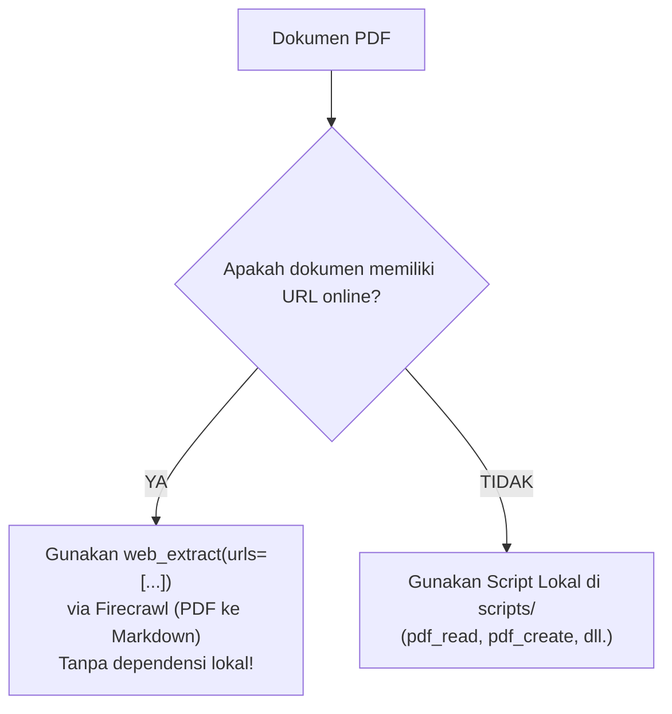

# PDF Manipulation Skill

Skill ini memberdayakan AI agent untuk menangani seluruh siklus hidup dokumen PDF secara terstruktur, efisien, dan andal: **Create, Read, Merge, Split, Fill Forms, Secure, OCR, Stamping, dan Metadata Management**.

Semua peralatan pembantu tersedia dalam bentuk modul CLI mandiri di folder `scripts/` (atau `skills/pdf/scripts/`) dan memiliki flag `--help`.

---

## 1. Aturan Utama: Penanganan URL vs Dokumen Lokal

Sebelum memproses dokumen, periksa lokasi sumber dokumen:



> [!IMPORTANT]
> **Aturan Ekstraksi OCR URL-First:**
> Jika dokumen memiliki URL online, **SELALU coba `web_extract` terlebih dahulu!**
> ```python
> web_extract(urls=["https://arxiv.org/pdf/2402.03300"])
> web_extract(urls=["https://example.com/report.pdf"])
> ```
> Pendekatan ini menangani konversi PDF-ke-Markdown langsung melalui Firecrawl tanpa membebani perangkat dengan dependensi lokal atau model OCR berat.
>
> **Catatan Kritis:** `web_extract` selalu menggunakan URL (bukan path file lokal).
> Baca rincian selengkapnya di [references/ocr-extraction.md](references/ocr-extraction.md).

---

## 2. Peta Referensi Cepat

| Kebutuhan / Topik | Panduan Detail |
|---|---|
| Strategi OCR, Firecrawl `web_extract`, dan Ekstraksi Teks Lokal | [references/ocr-extraction.md](references/ocr-extraction.md) |
| Format Skema JSON Pembuatan Dokumen & Formulir Isian | [references/form-specs.md](references/form-specs.md) |
| Lembar Contekan Lengkap Seluruh Perintah Terminal (CLI) | [references/cli-cheatsheet.md](references/cli-cheatsheet.md) |

---

## 3. Toolkit CLI & Alur Kerja (Workflow)

Semua script dapat dijalankan langsung di terminal menggunakan python:

### A. Membuat Dokumen & Formulir
1. **Membuat Dokumen dari JSON Spec:**
   ```bash
   python scripts/pdf_create.py spec.json -o out.pdf
   ```
   Mendukung judul, heading hierarkis, paragraf, garis pemisah, tabel otomatis bergaris/bergaya, gambar, list poin, nomor halaman dinamis dua-arah (*Page X of Y*), dan margin kustom.

2. **Membuat Formulir Isian AcroForm:**
   ```bash
   python scripts/pdf_make_form.py formspec.json -o form.pdf
   ```
   Membangun PDF formulir interaktif standar Acrobat dengan kolom teks, kotak centang (checkbox), dropdown/combobox, tombol radio, dan kotak tanda tangan.

3. **Linting Tata Letak Formulir Sebelum Dibangun:**
   ```bash
   # Linting aturan batas dan tabrakan field
   python scripts/pdf_form_layout.py formspec.json

   # Visualisasi kotak bounding box pada gambar
   python scripts/pdf_form_layout.py formspec.json --render-overlay boxes.png [--pdf form.pdf]
   ```
   Mendeteksi tabrakan koordinat (*bounding box collision*), field di luar batas halaman (*out of bounds*), ukuran target sentuh terlalu kecil, atau nama field duplikat.

---

### B. Membaca & Menganalisis Dokumen
1. **Mengekstrak Teks Dokumen:**
   ```bash
   python scripts/pdf_read.py doc.pdf --text           # Struktur JSON per halaman
   python scripts/pdf_read.py doc.pdf --text --raw     # Output teks mentah
   ```

2. **Mengekstrak Tabel & Export CSV:**
   ```bash
   python scripts/pdf_read.py doc.pdf --tables --csv-dir ./tabel_csv/
   ```
   Menggunakan `pdfplumber` untuk mengekstrak struktur sel tabel dan menyimpannya sebagai berkas CSV individual.

3. **Inspeksi Metadata & Deteksi Scanned PDF:**
   ```bash
   python scripts/pdf_read.py doc.pdf --meta
   ```
   Menampilkan metadata, dimensi halaman, status enkripsi, serta analisis heuristik apakah dokumen berupa hasil pindaian (*scanned image*) yang memerlukan OCR.

4. **Memeriksa Field Formulir:**
   ```bash
   python scripts/pdf_read.py form.pdf --fields
   ```
   Mendaftar semua widget formulir, tipe input, nilai saat ini, dan nilai bawaan (*default value*).

---

### C. Manipulasi Halaman, Penggabungan, & Pemotongan
1. **Menggabungkan Dokumen (Merge):**
   ```bash
   python scripts/pdf_merge.py a.pdf b.pdf c.pdf -o merged.pdf [--bookmarks]
   ```

2. **Memotong atau Merotasi Halaman (Split):**
   ```bash
   python scripts/pdf_split.py doc.pdf --pages 1-3,7 -o part.pdf [--rotate 90]
   ```

---

### D. Pengisian Formulir & Keamanan
1. **Mengisi Formulir Digital (Fill AcroForm):**
   ```bash
   python scripts/pdf_fill_form.py form.pdf --fields-json values.json -o filled.pdf [--flatten]
   ```
   Flag `--flatten` membekukan field interaktif menjadi elemen dokumen permanen sehingga tidak dapat diubah kembali.

2. **Enkripsi & Dekripsi Dokumen (Secure):**
   ```bash
   python scripts/pdf_secure.py doc.pdf --encrypt -o enc.pdf --user-password rahasia
   python scripts/pdf_secure.py enc.pdf --decrypt -o dec.pdf --password rahasia
   ```
   Mengamankan PDF menggunakan standar AES-256 tingkat industri.

---

### E. Watermark, Stempel, Gambar, & Lampiran
1. **Watermark / Cap Dokumen:**
   ```bash
   python scripts/pdf_watermark.py doc.pdf --stamp mark.pdf -o stamped.pdf [--under]
   ```
   Gunakan `--under` untuk meletakkan watermark di lapisan latar belakang (di balik teks).

2. **Stempel Teks atau Gambar Transparan:**
   ```bash
   # Stempel teks miring
   python scripts/pdf_stamp.py doc.pdf -o out.pdf --text "DRAFT" --x 150 --y 400 \
       --font-size 60 --rotation 45 --opacity 0.3 --color "#cc0000" [--pages 1-3]

   # Stempel gambar tanda tangan
   python scripts/pdf_stamp.py doc.pdf -o out.pdf --image sig.png --x 400 --y 60 --width 120
   ```

3. **Konversi Halaman ke Gambar:**
   ```bash
   python scripts/pdf_page_image.py doc.pdf --pages 1-3 --dpi 150 --out-dir imgs/
   ```

4. **Kelola Metadata & Lampiran Berkas:**
   ```bash
   python scripts/pdf_meta.py doc.pdf --set-meta --title "Judul" --author "Penulis" -o out.pdf
   python scripts/pdf_meta.py doc.pdf --attach data.csv -o out.pdf
   python scripts/pdf_meta.py doc.pdf --list-attachments
   python scripts/pdf_meta.py doc.pdf --extract-attachments ./extracted/
   ```

---

## 4. Prinsip Kerja Agen (Agent Guidelines)

1. **Selalu Validasi Sebelum Membangun:** Jika membuat formulir interaktif yang kompleks, jalankan `pdf_form_layout.py` terlebih dahulu untuk memastikan tidak ada input yang tumpang tindih.
2. **Hemat Resource & Baterai:** Jangan langsung menjalankan OCR model berat pada perangkat lokal jika dokumen memiliki URL online; selalu manfaatkan `web_extract`.
3. **Konfirmasi Tindakan Destruktif / Proteksi:** Saat mengenkripsi dokumen penting, pastikan kata sandi tercatat dengan aman dalam konteks sesi atau disampaikan kepada pengguna.
