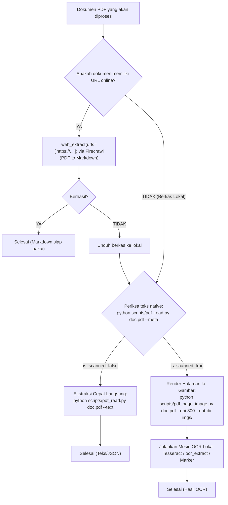

# Panduan OCR & Ekstraksi Teks PDF (OCR Extraction Guide)

Dokumen ini menjelaskan strategi ekstraksi teks dan OCR untuk berkas PDF, membedakan secara tegas penanganan antara **dokumen berbasis URL/Web** dan **dokumen lokal di perangkat**.

---

## 1. Aturan Emas: URL-First dengan `web_extract`

> [!IMPORTANT]
> **Jika dokumen PDF memiliki URL (berasal dari web/internet), SELALU coba `web_extract` terlebih dahulu!**
>
> Contoh pemanggilan:
> ```python
> web_extract(urls=["https://arxiv.org/pdf/2402.03300"])
> web_extract(urls=["https://example.com/report.pdf"])
> ```

### Mengapa `web_extract`?
1. **Konversi PDF ke Markdown via Firecrawl**: Menangani parsing dokumen PDF langsung menjadi Markdown yang rapi, terstruktur, mempertahankan heading, list, dan tabel.
2. **Zero Local Dependencies**: Tidak membebani memori (RAM), CPU, atau storage perangkat lokal dengan model OCR berukuran gigabyte atau binary berat.
3. **Hasil Bersih**: Menghindari artefak OCR (seperti karakter rusak, spasi ganda, atau kolom bertumpuk).

### Catatan Kritis untuk OCR Extraction:
- **`web_extract` SELALU menggunakan URL.**
- Jangan gunakan `web_extract` dengan path lokal (misal `/sdcard/doc.pdf` atau `./file.pdf`). Untuk berkas lokal, gunakan alur kerja lokal di bawah ini.

---

## 2. Alur Pengambilan Keputusan (Decision Tree)



---

## 3. Alur Kerja Berkas Lokal (Local PDF Workflow)

Jika dokumen disimpan secara lokal pada sistem:

### Langkah 1: Inspeksi Metadata & Deteksi Teks Native
Jalankan `pdf_read.py` dengan flag `--meta`:
```bash
python scripts/pdf_read.py dokumen.pdf --meta
```

Output JSON akan memberikan indikator cerdas `scanned_detection`:
```json
{
  "is_encrypted": false,
  "total_pages": 5,
  "scanned_detection": {
    "is_scanned": false,
    "confidence": "low",
    "total_chars": 3420,
    "avg_chars_per_page": 684.0,
    "has_images": false,
    "recommendation": "Native text available."
  }
}
```

- Jika `is_scanned` adalah `false`: **Dokumen memiliki teks digital native**. Tidak perlu OCR!
  Ekstrak langsung per halaman:
  ```bash
  python scripts/pdf_read.py dokumen.pdf --text -o hasil.json
  # Atau ekstrak teks mentah langsung ke terminal/file:
  python scripts/pdf_read.py dokumen.pdf --text --raw
  ```

- Jika `is_scanned` adalah `true`: **Dokumen berupa pindaian/scan atau gambar tanpa layer teks**. Lanjutkan ke Langkah 2.

---

### Langkah 2: Render Halaman Menjadi Gambar
Gunakan `pdf_page_image.py` dengan resolusi DPI optimal untuk OCR (antara 200 hingga 300 DPI):
```bash
python scripts/pdf_page_image.py scan_dokumen.pdf --pages 1-5 --dpi 300 --out-dir ./halaman_ocr/
```
Perintah di atas akan menghasilkan `page_001.png`, `page_002.png`, dst.

---

### Langkah 3: Ekstraksi OCR Lokal

#### Pilihan A: Menggunakan Tool Bawaan `ocr_extract` (Tesseract Termux / Lokal)
Jalankan tool OCR lokal untuk memproses gambar hasil render:
```bash
# Melalui Tesseract CLI:
tesseract halaman_ocr/page_001.png hasil_p1 -l ind+eng --psm 3
```

#### Pilihan B: Marker (Untuk Makalah Ilmiah, Formula Math, Multi-Kolom)
Jika dokumen lokal adalah buku, paper riset, atau memiliki rumus matematika yang padat dan sistem memiliki `marker-pdf`:
```bash
marker_single scan_dokumen.pdf --output_dir ./marker_out/
```
Marker menggunakan model vision-transformer untuk mengubah tata letak rumit, tabel dua kolom, dan LaTeX math ke Markdown.

---

## 4. Ringkasan Perbandingan Metode

| Metode | Input | Kecepatan | Kebutuhan Dependensi | Terbaik Untuk |
|---|---|---|---|---|
| **`web_extract` (Firecrawl)** | URL (`https://...`) | Sangat Cepat | 0 (Cloud Service) | PDF online, jurnal arXiv, laporan web, konversi langsung ke Markdown |
| **`pdf_read.py --text`** | File Lokal | Instan | Pure Python (`pypdf`) | PDF digital standar (dokumen Word/LaTeX yang diekspor ke PDF) |
| **`pdf_read.py --tables`** | File Lokal | Cepat | `pdfplumber` | Ekstraksi tabel tabular dan export ke CSV |
| **Render + Tesseract** | File Lokal | Sedang | Tesseract OCR | Dokumen pindaian kertas, kwitansi, KTP, scan scanner |
| **Marker** | File Lokal | Lambat (berat) | PyTorch / GPU | Makalah kompleks, formula matematika, buku cetak lama |
