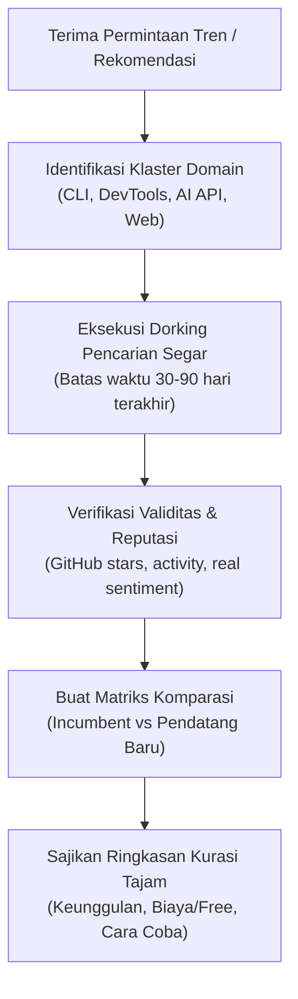

# Tech Trend Scout

Panduan operasional bagi agen AI untuk memindai, menyaring, dan menemukan informasi teknologi terbaru, *developer tools* mutakhir, dan ekosistem AI yang sedang tren lebih cepat dan lebih akurat daripada komunitas umum.

---

## 1. Ikhtisar & Prinsip Utama

Tujuan utama skill ini adalah **menghilangkan ketertinggalan informasi teknis**. Pengguna sering kali baru mendengar sebuah alat mutakhir (seperti terminal *Ghostty*, prompt *Starship*, atau platform API AI berbiaya hemat seperti *Inferhub*/*OpenRouter*) setelah teman atau rekannya merekomendasikannya.

### 4 Pilar Kurasi Tren:
1. **Kecepatan Sinyal Pertama (First Signal):** Ambil informasi langsung dari sumber primer (*Show HN*, rilis GitHub, r/LocalLLaMA, changelog resmi), bukan artikel daur ulang SEO/listicle generik.
2. **Filter Hype vs Realita (Signal-to-Noise Ratio):** Bedakan proyek *vaporware* atau sekadar *marketing gimmick* dengan alat yang benar-benar memecahkan masalah performa, kenyamanan (*DX - Developer Experience*), atau efisiensi biaya.
3. **Komparasi Tajam ("Mengapa Ini Lebih Baik?"):** Selalu sertakan pembanding langsung terhadap *incumbent* (misal: Ghostty vs Alacritty/WezTerm/Kitty; Starship vs Oh-My-Zsh; Inferhub vs OpenRouter vs OpenAI direct).
4. **Relevansi & Eksekusi Praktis:** Sertakan cara instalasi instan, model harga/deposit (untuk API), dan apakah alat tersebut kompatibel dengan lingkungan pengguna (macOS, Linux, Android/Termux).

---

## 2. Kapan Menggunakan Skill Ini

Gunakan skill ini secara otomatis ketika:
- Pengguna meminta rekomendasi teknologi atau tools terbaru ("ada tools dev apa yang lagi ramai?", "terminal apa yang paling kencang sekarang?").
- Pengguna mencari alternatif hemat, cepat, atau modern untuk tumpukan teknologi tertentu ("alternatif OpenAI API yang bisa deposit murah", "pengganti bash prompt biar keren").
- Pengguna menanyakan mengapa sebuah teknologi tiba-tiba populer ("apa itu Ghostty?", "kenapa orang beralih ke UV daripada Poetry/Pip?").
- Pengguna ingin melakukan riset pasar teknologi (*technology radar*) sebelum memulai proyek baru.

**JANGAN gunakan untuk:**
- Troubleshooting bug spesifik pada kode yang sedang berjalan (gunakan skill debugging/troubleshooter).
- Pencarian dokumentasi sintaksis library standar yang sudah mapan (misal: "cara pakai re.match di Python").

---

## 3. Peta Radar & Saluran Intelijen (Intelligence Sources)

Agen wajib memprioritaskan saluran-saluran berikut saat memindai tren via `web_search`:

| Kategori Radar | Sumber Intelijen Utama | Kata Kunci / Domain Target |
|---|---|---|
| **Modern CLI & Dev Tools** | GitHub Trending, Console.dev, Lobste.rs | `site:github.com/trending`, `"Show HN" terminal OR cli`, `console.dev tools` |
| **AI Models & API Hemat** | r/LocalLLaMA, Artificial Analysis, OpenRouter | `artificialanalysis.ai leaderboard`, `site:reddit.com/r/LocalLLaMA trending`, `site:openrouter.ai/models` |
| **Open Source Breakthroughs** | Hacker News, GitHub Explore, ProductHunt | `news.ycombinator.com "Show HN"`, `"trending repositories" site:github.com` |
| **System & Terminal Performance** | Zig, Rust, Go communities, Phoronix | `ghostty terminal benchmark`, `"written in rust" terminal faster` |
| **Self-Hosted & Automation** | r/selfhosted, Awesome-Selfhosted | `site:reddit.com/r/selfhosted "just released" OR "alternative"` |

---

## 4. Alur Kerja Investigasi Tren (Step-by-Step Workflow)



### Langkah 1: Klasifikasi Kebutuhan & Intent
Tentukan fokus pengguna:
- **Performa Murni:** Mencari kecepatan eksekusi (contoh: Ghostty dengan rendering GPU, Bun/Biem vs Node, UV vs Pip, Ripgrep vs Grep).
- **Estetika & Ergonomi (DX):** Tampilan terminal indah, zero-config (contoh: Starship prompt, Zoxide, Eza, Bat, Lazygit).
- **Efisiensi Finansial (AI/Cloud):** Akses model besar (Claude 3.5 Sonnet, GPT-4o, DeepSeek, Llama 3) dengan sistem saldo/deposit tanpa langganan bulanan mahal (contoh: Inferhub, OpenRouter, DeepInfra, Groq, Together AI).

### Langkah 2: Eksekusi Pencarian Segar (Fresh Query Blueprints)
Hindari pencarian umum seperti `best tools 2026`. Gunakan pola pencarian tajam berikut pada `web_search`:

1. **Untuk Developer Tools & CLI Terbaru:**
   ```text
   "Show HN" ("terminal" OR "prompt" OR "developer tool" OR "cli") 2026
   site:github.com trending rust cli terminal 2026
   "alternative to" (alacritty OR iterm2 OR oh-my-zsh) faster
   ```
2. **Untuk Provider API AI & Model Hemat:**
   ```text
   "cheapest api" ("claude 3.5" OR "gpt-4o" OR "deepseek") deposit "pay as you go"
   site:reddit.com/r/LocalLLaMA ("api provider" OR "inferhub" OR "openrouter")
   artificialanalysis.ai "price per million tokens"
   ```
3. **Untuk Ekosistem yang Sedang Viral:**
   ```text
   site:news.ycombinator.com "ghostty" OR "starship" OR "inferhub"
   "why everyone is switching to" developer tools
   ```

### Langkah 3: Saringan Validasi (Filter Sinyal vs Sampah)
Sebelum merekomendasikan sebuah tool kepada pengguna, periksa 4 indikator kesehatan proyek:
1. **Kecepatan Update (Freshness):** Apakah ada commit atau rilis dalam 30 hari terakhir?
2. **Kredibilitas Pengembang:** Siapa pembuatnya? (Contoh: Ghostty dibuat oleh Mitchell Hashimoto, kreator Terraform/Vagrant — sinyal kualitas sangat tinggi).
3. **Model Monetisasi & Keamanan:** Apakah open-source, freemium, atau berbayar? Untuk penyedia API: apakah mendukung *deposit/prepaid* (tidak menagih otomatis kartu kredit) dan memiliki *uptime rate* stabil?
4. **Sentimen Nyata Komunitas:** Cari keluhan di issue tracker atau Reddit (misal: "apakah ada kendala latensi atau privasi log?").

### Langkah 4: Format Penyajian Hasil kepada Pengguna
Sajikan jawaban dalam format ringkas, padat, dan langsung menjawab inti rasa penasaran pengguna:

1. **Nama Tool & Tagline Singkat:** Apa itu dan siapa pembuatnya?
2. **Mengapa Sedang Trending (The "Secret Sauce"):** Keunggulan pembeda dibanding pemain lama (misal: "Ghostty me-render via Metal/OpenGL sehingga input latency hampir 0ms dibanding iTerm2").
3. **Perbandingan Langsung (Head-to-Head):**
   - *Pemain Lama (Incumbent):* Misal Alacritty / iTerm2 / Oh-My-Zsh.
   - *Kelebihan Baru:* Misal Starship ditulis dengan Rust, cross-shell (Zsh/Bash/Fish/PowerShell), dan instan (<10ms).
4. **Model Akses & Harga:** Gratis / Open Source / Deposit minimum (misal untuk API hub).
5. **Cara Coba Cepat (Quick Start):** 1 baris perintah instalasi atau URL resmi.

---

## 5. Direktori Pengetahuan Tren Cepat (Curated Cheat Sheet)

Daftar acuan teknologi mutakhir yang telah divalidasi dan sering menjadi tolok ukur pembicaraan komunitas developer:

### A. Terminal & Shell Experience
- **Ghostty:** Terminal emulator berbasis GPU yang cepat, ditulis dalam Zig oleh Mitchell Hashimoto. Fitur: natif di macOS & Linux, rendering teks kristal, dukungan tab natif, latensi input terendah.
- **Starship:** Prompt shell minimalis, sangat cepat, dan dapat dikustomisasi tanpa batas. Ditulis dalam Rust, jalan di bash, zsh, fish, termux, powershell.
- **Zoxide:** Pengganti perintah `cd` yang mengingat direktori yang paling sering dikunjungi (`z nama-folder`).
- **Atuin:** Pengganti riwayat shell (*history*) dengan sinkronisasi terenkripsi, pencarian interaktif, dan statistik eksekusi.
- **Eza / Bat / Ripgrep:** Tiga serangkai pengganti modern untuk `ls`, `cat`, dan `grep`.

### B. Penyedia API & AI Inference Efisien
- **OpenRouter:** Agregator API multi-model paling populer. Mendukung sistem deposit saldo, *fallback routing* otomatis jika provider down, dan akses ke ratusan model open & closed-source.
- **Inferhub / Infermatic:** Platform penyedia inferensi berbiaya rendah dengan skema deposit saldo fleksibel, ideal untuk pengembang independen tanpa komitmen bulanan enterprise.
- **DeepInfra / Together AI / Groq:** Provider inferensi LPU/GPU ultra-cepat untuk model open-source (Llama 3, DeepSeek, Qwen) dengan harga per-token yang jauh lebih murah dibanding OpenAI/Anthropic langsung.
- **Ollama / LM Studio:** Mesin inferensi lokal paling praktis untuk menjalankan model GGUF di laptop/komputer pribadi secara 100% offline.

### C. Modern Tooling & Runtimes
- **UV (Astral):** Package manager & installer Python berbasis Rust. Kecepatan 10–100x lebih cepat dibanding `pip` dan `pip-tools`.
- **Bun:** Alternatif Node.js & npm all-in-one yang sangat cepat, ditulis dalam Zig dengan JavaScriptCore engine.
- **Birome (Biome):** Linter dan formatter JavaScript/TypeScript berbasis Rust, pengganti Prettier dan ESLint dalam 1 binary instan.
- **Zed:** Code editor berbasis GPU dengan kolaborasi waktu-nyata, ditulis dalam Rust.

---

## 6. Jebakan Umum (Common Pitfalls)

- **Terjebak Artikel SEO Basi:** Banyak artikel blog medium atau portal berita yang hanya me-recycle "Best Terminal Apps in 2020". Selalu batasi atau verifikasi tahun rilis terkini via GitHub repo.
- **Mengabaikan Kompatibilitas Sistem:** Jika pengguna bekerja di Termux (Android ARM64), pastikan mengecek apakah binary tool tersebut tersedia untuk Linux/Android ARM64 sebelum merekomendasikannya.
- **Hype Tanpa Stabilitas:** Beri peringatan jujur jika sebuah tool masih berada dalam status *early alpha* atau *private beta* (misal butuh invite code atau compile manual dari source).
