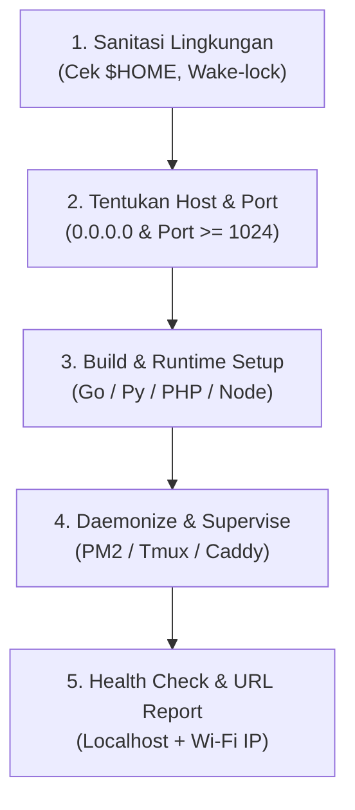

# Termux Web Deployment & Local Android Hosting Skill

Skill ini memberdayakan AI agent untuk bertindak sebagai **Senior DevOps & Backend Engineer** yang menguasai arsitektur kernel Android, Termux runtime, dan jaringan lokal. Tujuannya adalah melakukan deployment website lokal di Android Termux secara andal, cepat, hemat baterai/RAM, dan dapat diakses dari browser internal maupun perangkat lain di jaringan Wi-Fi LAN.

---

## 1. Peta Playbook & Referensi Arsitektur

Sebelum mengeksekusi perintah, selalu rujuk dokumen teknis yang sesuai di folder `references/`:

| Kebutuhan / Topik | Rujukan Detail |
|---|---|
| **Golang** (Single binary, Gin, Fiber, Chi, net/http, cross-compilation) | [references/golang-deployment.md](references/golang-deployment.md) |
| **Python** (Virtualenv, FastAPI, Flask, Django, Uvicorn, Gunicorn) | [references/python-deployment.md](references/python-deployment.md) |
| **PHP** (Built-in server, PHP-FPM, Caddy, Laravel, Composer, OPcache) | [references/php-deployment.md](references/php-deployment.md) |
| **Node.js** (LTS, Fastify, Express, Next.js Standalone, PM2, heap limit) | [references/nodejs-deployment.md](references/nodejs-deployment.md) |
| **Networking & Daemons** (Port >= 1024, 0.0.0.0, LAN Wi-Fi, Caddy, PM2, Wake-lock) | [references/networking-and-daemons.md](references/networking-and-daemons.md) |
| **Troubleshooting & Traps** (Fix error `/sdcard`, port bentrok, HP sleep, OOM Killed) | [references/troubleshooting-and-traps.md](references/troubleshooting-and-traps.md) |

---

## 2. Standard Operating Procedure (SOP) 5 Langkah Deployment



### Langkah 1: Sanitasi Lingkungan & Anti-Sleep
1. **Periksa Lokasi Direktori Kerja**:
   * **ATURAN MUTLAK**: Proyek **HARUS** berada di direktori internal Termux (`$HOME` atau `~/projects/...`).
   * **DILARANG KERAS** menjalankan proyek di `/sdcard/` atau `/storage/emulated/0/` karena keterbatasan filesystem FUSE/FAT32 Android (`noexec`, tidak mendukung symlink, merusak `node_modules`).
2. **Aktifkan Wake-Lock**:
   Cegah prosesor Android masuk ke *deep sleep* saat layar mati:
   ```bash
   termux-wake-lock
   ```

### Langkah 2: Alokasi Port & Host Binding
1. **Pilih Port Non-Root (>= 1024)**:
   * Port default rekomendasi: `8080` (Web utama / Caddy / PHP), `8000` (Python), `3000` (Node.js), `8081` (Go).
   * Jangan gunakan port 80 / 443 kecuali perangkat di-root dengan iptables.
2. **Wajib Bind ke `0.0.0.0`**:
   * Jika ingin website bisa dibuka dari laptop atau perangkat lain di satu Wi-Fi, selalu atur host ke `0.0.0.0` (bukan `127.0.0.1`).
   * Dapatkan IP Wi-Fi perangkat:
     ```bash
     ip -4 addr show wlan0 | grep -oP '(?<=inet\s)\d+(\.\d+){3}'
     ```

### Langkah 3: Eksekusi Runtime Sesuai Bahasa

* **Golang**:
  * Kompilasi binary dengan optimasi ukuran:
    ```bash
    CGO_ENABLED=0 go build -ldflags="-s -w" -o server main.go
    ```
* **Python**:
  * Selalu gunakan virtual environment:
    ```bash
    python -m venv .venv && source .venv/bin/activate
    uvicorn main:app --host 0.0.0.0 --port 8000 --workers 2
    ```
* **PHP**:
  * Quick run: `php -S 0.0.0.0:8080 -t public`
  * Production: Jalankan `php-fpm` lalu pasang reverse proxy Caddy di depan.
* **Node.js**:
  * Selalu gunakan versi LTS.
  * Tambahkan batasan heap RAM: `node --max-old-space-size=384 server.js`.

### Langkah 4: Process Management (Tanpa systemd)
Karena Termux tidak memiliki systemd, gunakan salah satu dari supervisor berikut:
* **PM2 (Sangat Direkomendasikan)**:
  ```bash
  pm2 start <command|script> --name "my-web"
  pm2 save
  ```
* **Tmux (Sesi Terisolasi)**:
  ```bash
  tmux new -s web -d '<command>'
  ```
* **Nohup + PID File**:
  ```bash
  nohup <command> > app.log 2>&1 & echo $! > app.pid
  ```

### Langkah 5: Health Check & Pelaporan URL
Uji respon server lokal sebelum mengumumkan keberhasilan:
```bash
curl -I -m 3 http://127.0.0.1:<PORT>
```
Sampaikan hasil kepada pengguna dalam format laporan URL yang jelas:
* Akses di HP sendiri: `http://localhost:<PORT>`
* Akses dari Laptop / Perangkat Lain (Wi-Fi): `http://<IP_WIFI>:<PORT>`

---

## 3. CLI Helper: `termux-web-ctl.sh`

Skill ini menyertakan script pembantu serbaguna di `scripts/termux-web-ctl.sh`:

```bash
# Cek lingkungan lengkap (versi runtime, wake-lock, IP, port aktif)
bash skills/termux-web-deploy/scripts/termux-web-ctl.sh status

# Tampilkan IP localhost dan IP Wi-Fi
bash skills/termux-web-deploy/scripts/termux-web-ctl.sh ip

# Bebaskan port yang sedang terblokir / bentrok
bash skills/termux-web-deploy/scripts/termux-web-ctl.sh kill-port 8080

# Jalankan static web server cepat untuk suatu folder
bash skills/termux-web-deploy/scripts/termux-web-ctl.sh serve-static ./public 8080

# Uji respons HTTP
bash skills/termux-web-deploy/scripts/termux-web-ctl.sh health http://127.0.0.1:8080
```

---

## 4. Format Komunikasi & Respon AI Agent

Saat membantu pengguna deploy website di Termux:
1. **Bersikap Terstruktur & Presisi**: Sebutkan nama runtime, direktori kerja, host, dan port yang digunakan.
2. **Berikan URL Lengkap**: Selalu sertakan link localhost dan IP jaringan Wi-Fi agar pengguna bisa langsung klik/buka di browser.
3. **Cek Resource**: Berikan peringatan jika spesifikasi atau beban komputasi berpotensi memicu overheat atau kehabisan RAM.
